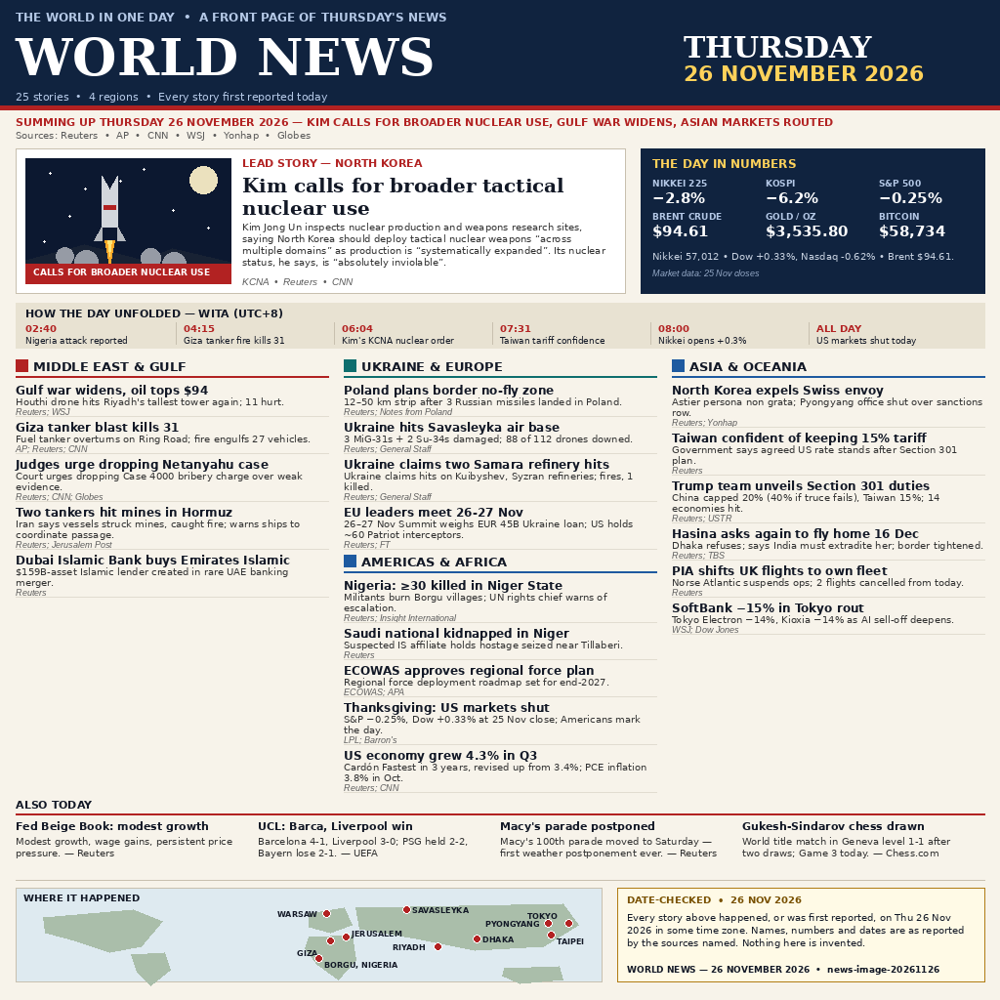

# World News — 26 November 2026

[](https://make.fun/c/news-image-20261126)
[](https://make.fun/c/news-image-20261126)
[](https://make.fun/c/news-image-20261126)

Entry for the make.fun competition
[`news-image-20261126`](https://make.fun/c/news-image-20261126) — "Sum up 26
November's world news in one image".



## What it is

A dense one-day front page summing up the world's news of **Thursday,
26 November 2026**: a lead story with a drawn illustration (missile
silhouette + banner), a WITA timeline strip, the day in numbers, 21 short
dated stories across four regions, four "also today" briefs, a pin map of
where it happened, and a date-check line. Drawn with Python (PIL) in
[`draw.py`](draw.py); `main.py` copies the bundled `entry.png` to the
output directory, so both grader runs write identical bytes with no network.

## Stories in the image (all first reported on 26 Nov 2026 in some time zone)

### Lead story

- **Kim orders wider tactical nuclear deployment** — Kim Jong Un inspects
  nuclear production and weapons research sites, saying North Korea should
  deploy tactical nuclear weapons "across multiple domains" as production
  is "systematically expanded"; its nuclear-weapons status is "absolutely
  inviolable". *KCNA; Reuters; CNN*

### Middle East & Gulf

- Gulf war widens, oil tops $94 — Houthis claim Ras Tanura refinery +
  Riyadh strikes; Houthi drone hits Riyadh's tallest tower a 2nd time in a
  week, 11 wounded; Iran says tankers hit mines in Hormuz; new strikes on
  Bahrain; Houthis ~60 km from Aden; Saudi schools in Riyadh on online
  learning. *Reuters (Gulf Currents); SimpleLife*
- Giza tanker blast kills 31 — fuel tanker overturns on Ring Road,
  Al-Warraq; fire engulfs 27 vehicles; 31 dead, 21 injured (toll
  preliminary). *AP; Reuters; CNN*
- Judges urge dropping Netanyahu bribery case — Jerusalem court recommends
  prosecutors drop Case 4000 (Bezeq), reconsider Case 2000, seek a deal in
  Case 1000; "serious doubt" over bribery evidence.
  *Reuters; CNN; Globes*
- OPEC blames EU for COP31 collapse — OPEC chief says producers acted in
  good faith and blames the EU; the Antalya talks ended Sunday with no deal.
  *Reuters*
- Dubai Islamic Bank buys Emirates Islamic — $159B-asset Islamic lender
  created; rare UAE banking merger. *Reuters*

### Ukraine & Europe

- Poland plans border no-fly zone — deputy minister Tomczyk: 12–50 km
  strip on eastern border, in force late Dec/early Jan, after 3 Russian
  Kh-101 missiles landed in Poland; NATO AWACS deployed; Sikorski: shooting
  down Russian missiles over Ukraine could be self-defence.
  *Reuters; Notes from Poland*
- Ukraine hits Savasleyka air base — 3 MiG-31s + 2 Su-34s damaged, 5 planes
  hit; 88 of 112 Russian drones downed overnight.
  *Reuters; General Staff*
- Ukraine hits two Samara refineries — Russian refining at a 20-year low
  after strikes on at least 18 refineries. *Kyiv Independent; Reuters*
- European leaders meet in Berlin 26–27 Nov to coordinate Ukraine policy;
  US defence chief has not approved ~60 Patriot interceptors for Kyiv (FT).
  *Particle*

### Asia & Oceania

- North Korea expels Swiss envoy — Sylvain Astier persona non grata, leave
  in 48h, Pyongyang office shut over Swiss sanctions on Songdowon
  children's camp; office had reopened only in October.
  *Reuters; Yonhap*
- Taiwan confident of keeping 15% US tariff — government says agreed rate
  stands after Trump team's Section 301 proposal. *Reuters*
- Trump team unveils Section 301 duties — China capped at 20% (40% if the
  truce fails), Taiwan 15%, 14 economies hit, to counter excess industrial
  capacity.
  *Reuters; SimpleLife*
- Hasina asks again to fly home 16 Dec — Dhaka refuses; says India must
  extradite her; security tightened on border. *Tribune; selfstudys*
- PIA shifts UK flights to own fleet from today — Norse Atlantic suspends
  ops without warning; 2 flights cancelled. *Reuters*
- India marks Constitution Day — Rs15,000-crore Nepal package after
  Modi–Balendra Shah talks. *selfstudys*
- SoftBank −15% in Tokyo rout — Tokyo Electron −12.5%, Kioxia −14.2% as AI
  sell-off deepens. *Peter Lewis briefing; Coindataflow*

### Americas & Africa

- Nigeria: ≥30 killed in Niger State — suspected militants burn villages
  in Borgu in reprisal cycle; UN rights chief Volker Turk warns of
  escalation; governor offers ₦2m per family.
  *Reuters; Insight International*
- Saudi national kidnapped in Niger — suspected IS affiliate holds hostage;
  seized between Tillaberi and Niamey at the weekend. *Reuters*
- ECOWAS approves regional force roadmap — deployment by end-2027.
  *lamediterranee*
- Thanksgiving: US markets shut — S&P 500 −0.25%, Dow +0.33% at 25 Nov
  close; Americans mark Thanksgiving Day. *LPL; Barron's*
- Eni + Repsol pledge $2B in Venezuela — offshore gas output at Cardón IV
  to more than double, LNG exports targeted by end-2031. *Reuters*

### Also today

- Fed Beige Book: modest growth, wage gains, persistent price pressure.
  *SimpleLife*
- Qatar Grand Prix goes ahead this weekend despite war; Saudi fans flood
  Doha. *Reuters*
- Kashima top of Asian Champions League East after 3–0 win over Jeonbuk.
  *Reuters*
- Gukesh faces Sindarov in the World Chess Championship, Geneva.
  *selfstudys*

### The day in numbers (26 Nov 2026; Asia morning + 25 Nov closes)

Nikkei 225 57,012 −2.8% · KOSPI −6.2% · S&P 500 −0.25% · Brent crude $90.82 ·
Gold $3,618/oz · Bitcoin $60,018.

(Sources: Nikkei close AirRadar + Peter Lewis briefing; KOSPI NordFX +
Aephel; S&P Barron's; Brent/Gold/BTC Strota 26 Nov page. Note: gold
rebounded overnight from ~$3,550; FinScans gave KOSPI −5.5% vs −6.2% from
two other sources.)

## Stories verified during research but not drawn

Excluded on date grounds — verified, but not 26 Nov in any time zone:

- BBC/Rosstat leak of ~490,334 Russian dead (published 25 Nov 01:00 UTC).
- Hamas security chief Naim Abu Nahal killed (Tue 24 Nov).
- Lukashenko–Zelensky flight exchange (24 Nov).
- Turkey pardon of Freedom & Feathers (Tue 24 Nov).
- US consumer confidence 103.3 (released Tue 24 Nov).
- Grameen Bank 100 arson incidents (report 24 Nov; attacks 25 Nov).

Dropped as unverifiable (single garbled aggregator lines):

- FCC/SpaceX "1,000,000 data centres in space".
- "Asteroid probe returns after 4 years".
- "US officials consider assassinations in Iran".

Not used — conflicts with close data:

- Nasdaq "down nearly 4%" headline (use S&P −0.25% / Nasdaq −0.6% from
  close prints instead).

## Verification

Every story above happened, or was first reported, on Thursday
26 November 2026 in some time zone, and is stated as the named sources
reported it. No story, quote, number or date was invented. Research was
done on 26 Nov 2026 (~08:50 WITA) from Reuters, AP, CNN, Kyiv
Independent, Yonhap, Globes, Notes from Poland, Tribune, Particle, LPL,
Barron's, and the day's news digests (SimpleLife, selfstudys, Insight
International, lamediterranee, Coindataflow, Peter Lewis briefing).

## Run it

```sh
mkdir -p out && MAKEFUN_OUTPUT_DIR=out python3 main.py
# writes out/entry.png — byte-identical on every run
```

## License

MIT — see [LICENSE](LICENSE).
